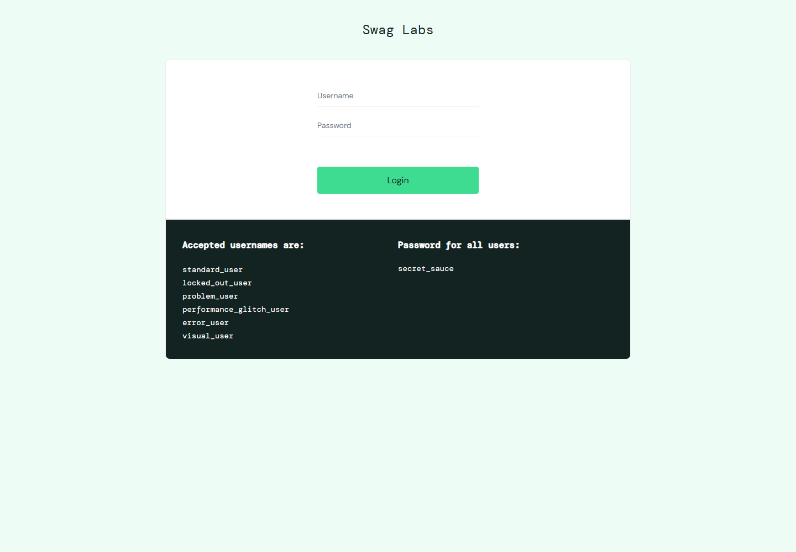
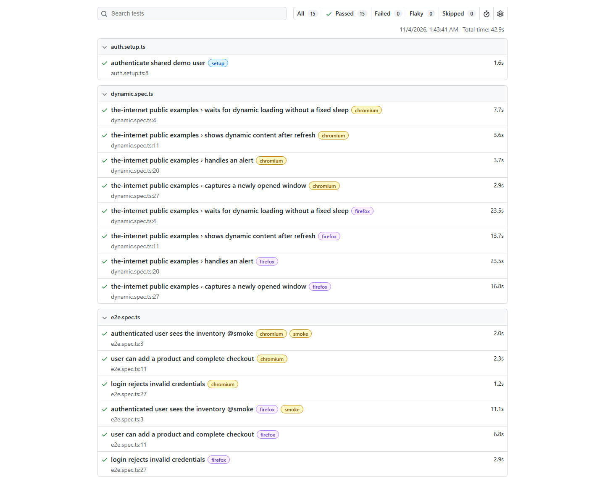
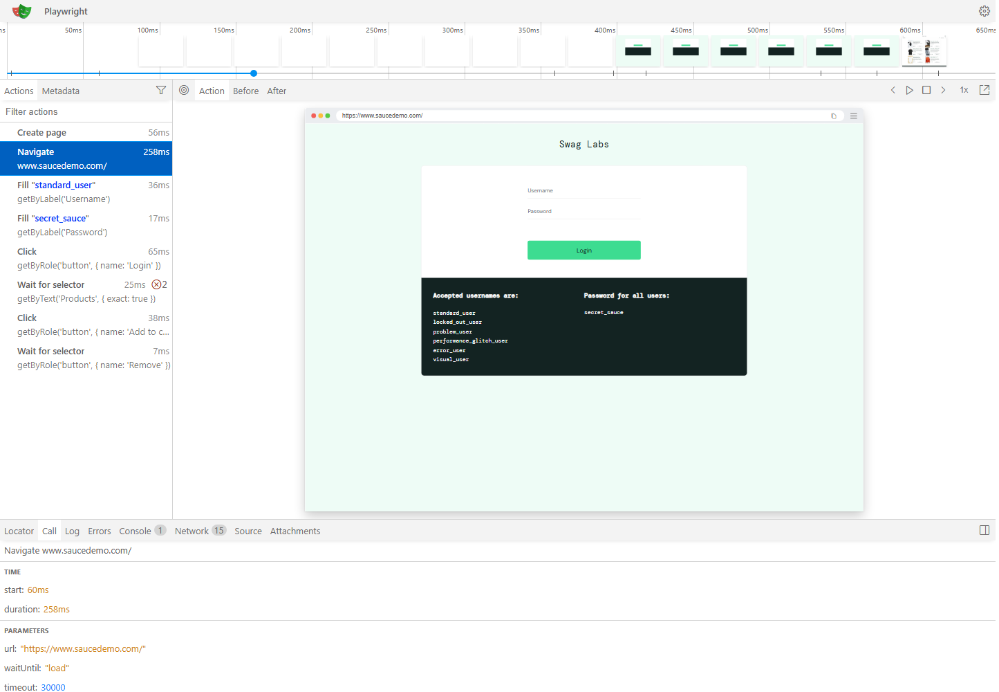
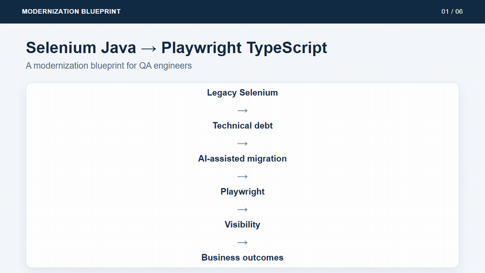
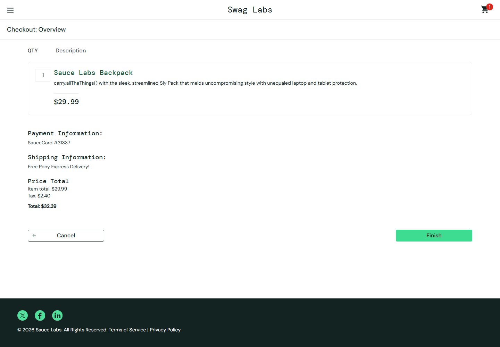

# Selenium Java → Playwright TypeScript Modernization Blueprint

### A hands-on modernization blueprint for QA engineers

Companion material for **Modernizing the Monolith: Accelerating Playwright Migration with AI and Automated Visibility**. Follow the examples from legacy Selenium debt through reviewed AI-assisted migration to Playwright tests and useful reporting.

> [!IMPORTANT]
> This repository is an educational learning guide, not a production framework template. It uses only public test sites: [SauceDemo](https://www.saucedemo.com) and [The Internet](https://the-internet.herokuapp.com).

## What You'll Learn

- Identify common Selenium anti-patterns and explain why they are fragile.
- Translate Selenium Java + TestNG concepts into Playwright TypeScript.
- Choose resilient locators and replace fixed waits with web-first assertions.
- Use cloud or local AI responsibly during migration.
- Review AI-generated code and preserve the original test intent.
- Add lightweight reporting and measure modernization outcomes.

## Who This Repository Is For

This repository is intended for:

- QA engineers moving from Selenium Java to Playwright.
- Test automation engineers modernizing legacy suites.
- Teams evaluating AI-assisted migration approaches.
- Architects planning maintainable test automation.
- Meetup attendees following the Modernization Blueprint presentation.

It is a learning blueprint, not a production-ready framework template.

## Validation Status

| Check | Result |
|---|---|
| TypeScript strict type-check | ✅ Passed (`npm run typecheck`) |
| Playwright suite | ✅ 15 tests passed |
| Chromium | ✅ Passed |
| Firefox | ✅ Passed |
| HTML, JUnit, and Jira-shaped reporter output | ✅ Generated |
| Selenium Java execution | ⚠ Included, but not verified in this environment (Java and Maven were unavailable) |

Playwright results were verified against the public demo sites. Those sites can change, so rerun the suite after cloning before using it for a live demo.

## Project Screenshots

The images show the public app used by the Selenium example, the generated Playwright report, and the Playwright Trace Viewer.

<table>
  <tr>
    <th>Legacy Selenium example: app under test</th>
    <th>Playwright HTML report</th>
  </tr>
  <tr>
    <td></td>
    <td></td>
  </tr>
  <tr><th colspan="2">Playwright Trace Viewer: recorded browser actions and page snapshots</th></tr>
  <tr><td colspan="2"></td></tr>
</table>

Refresh these images after running the tests by going to `playwright-ts-modern/` and running `npm run capture:readme`. The script uses the public demo site and the latest local HTML report.

## Repository Tour



Regenerate the tour from the repository root with `node playwright-ts-modern/scripts/create-repository-tour.cjs`. It uses the screenshots and source files already in this repository; install FFmpeg and the Playwright Chromium browser first.

### Start here

1. Read [the modernization journey](#the-modernization-journey).
2. Try a test manually with [the guided example](#manual-walkthrough-run-the-checkout-by-hand).
3. Run the Playwright suite using [the setup steps](#2-run-the-playwright-examples).
4. Compare it with the legacy examples and review the [migration cheat sheet](docs/Selenium-Java-to-Playwright-TS-CheatSheet.md).

<details>
<summary><strong>Contents</strong></summary>

- [What You'll Learn](#what-youll-learn)
- [Validation Status](#validation-status)
- [Project Screenshots](#project-screenshots)
- [Repository Tour](#repository-tour)
- [Who This Repository Is For](#who-this-repository-is-for)
- [The modernization journey](#the-modernization-journey)
- [Repository map](#repository-map)
- [1. Run the Selenium examples](#1-run-the-selenium-examples)
- [2. Run the Playwright examples](#2-run-the-playwright-examples)
- [3. Compare the migration](#3-compare-the-migration)
- [Manual walkthrough: run the checkout by hand](#manual-walkthrough-run-the-checkout-by-hand)
- [AI-assisted migration workflow](#4-ai-assisted-migration-workflow)
- [Reporting and visibility](#5-reporting-and-visibility)
- [Suggested meetup walkthrough](#6-suggested-meetup-walkthrough)

</details>

## Modernization journey

```text
Legacy Selenium implementation
          ↓
Technical debt discovery
          ↓
AI-assisted migration (review every change)
          ↓
Playwright modernization
          ↓
Reporting and visibility
          ↓
Business outcomes: speed, stability, lower maintenance
```

## Repository map

| Path | What to learn |
|---|---|
| [`selenium-java-legacy/`](selenium-java-legacy/) | Java 17, Maven, TestNG, manual WebDriver lifecycle, and three intentional legacy smells. |
| [`playwright-ts-modern/`](playwright-ts-modern/) | Strict TypeScript, Playwright Test, setup project, cached auth state, page object, fixture, specs, and reporters. |
| [`ai-prompts/`](ai-prompts/) | Scoped prompts for cloud/local migration, locators, page objects, and code review. |
| [`docs/migration-manifest.md`](docs/migration-manifest.md) | Selenium concepts mapped to Playwright concepts, with migration rationale. |
| [`docs/cloud-vs-local-ai.md`](docs/cloud-vs-local-ai.md) | Choosing a model workflow based on data policy and practical constraints. |
| [`docs/ai-review-checklist.md`](docs/ai-review-checklist.md) | Human review checkpoints before trusting generated code. |
| [`docs/measuring-modernization.md`](docs/measuring-modernization.md) | Compare run time, flakiness, parallel throughput, and maintenance. |
| [`docs/talk-mapping.md`](docs/talk-mapping.md) | Map this repository to the meetup narrative. |
| [`docs/Selenium-Java-to-Playwright-TS-CheatSheet.md`](docs/Selenium-Java-to-Playwright-TS-CheatSheet.md) | Printable, scannable migration reference. |

## 1. Run the Selenium examples

Requirements: Java 17+, Maven 3.9+, and Google Chrome. Selenium Manager obtains a compatible ChromeDriver when needed.

```powershell
cd selenium-java-legacy
mvn test
```

Examples:

- `LoginTest`: hardcoded public demo credentials and `Thread.sleep`.
- `CartTest`: a structural XPath selector tied to the first product's DOM position.
- `DynamicContentTest`: manual sleep polling on The Internet's dynamic loading page.

These patterns are deliberately shown as migration material. They demonstrate why tests can be slow, brittle, and difficult to maintain.

## 2. Run the Playwright examples

Requirements: Node.js 20+. From the repository root:

```powershell
cd playwright-ts-modern
npm install
npx playwright install chromium firefox
npx playwright test
```

The setup project signs in once to the public SauceDemo account and writes browser state under `.auth/`. Chromium and Firefox test projects reuse that state, so ordinary inventory/cart tests do not repeat login. The auth directory is ignored by Git. To use another permitted demo account, copy `.env.example` to `.env` and set `SAUCE_USERNAME` and `SAUCE_PASSWORD`.

Useful commands:

| Command | Purpose |
|---|---|
| `npm test` | Run all projects/specs. |
| `npm run typecheck` | Check the strict TypeScript project without running browsers. |
| `npm run test:headed` | Watch browsers while tests run. |
| `npm run test:ui` | Explore and debug in Playwright UI mode. |
| `npm run test:smoke` | Run tests tagged `@smoke`. |
| `npm run test:dynamic` | Run The Internet dynamic loading/content, alert, and window examples. |
| `npx playwright test --debug` | Open the Playwright Inspector. |
| `npx playwright show-trace test-results/<trace>.zip` | Inspect a trace captured on retry. |
| `npm run report` | Open the HTML report after a run. |

Playwright writes HTML, JUnit XML, and Jira-shaped JSON under `playwright-report/` and `test-results/`. Traces are captured on first retry; screenshots are saved on failure. CI mode (`CI=true`) forbids focused tests, retries failures, and caps workers.

## Manual walkthrough: run the checkout by hand

This exercise lets you understand the user journey before looking at the automation. No code or browser extensions are needed.

### SauceDemo: login → inventory → cart → checkout

1. Open [saucedemo.com](https://www.saucedemo.com).
2. Sign in with the public demo account: `standard_user` / `secret_sauce`.
3. On **Products**, choose **Add to cart** for **Sauce Labs Backpack**.
4. Open the cart and confirm the backpack is listed.
5. Choose **Checkout**, enter any sample first name, last name, and postal code, then continue.
6. Review the order summary, choose **Finish**, and confirm the order completion message.

<details>
<summary>View a sample checkout overview</summary>



</details>

| Manual action | Automated example |
|---|---|
| Sign in and arrive at Products | `src/tests/auth.setup.ts` and `src/pages/LoginPage.ts` |
| Find the Backpack and add it | `src/tests/e2e.spec.ts` and `src/pages/InventoryPage.ts` |
| Review cart and finish checkout | `src/tests/e2e.spec.ts` |

### The Internet: dynamic behavior

Open each page below and try the action. These are separate examples and do not require a login.

| Page | Try this | Expected result | Automated example |
|---|---|---|---|
| [Dynamic Loading](https://the-internet.herokuapp.com/dynamic_loading/2) | Choose **Start** | **Hello World!** appears after loading. | `dynamic.spec.ts` — waits with a web-first assertion. |
| [Dynamic Content](https://the-internet.herokuapp.com/dynamic_content) | Choose **click here** | The page refreshes and displays content rows. | `dynamic.spec.ts` — checks content before and after refresh. |
| [JavaScript Alerts](https://the-internet.herokuapp.com/javascript_alerts) | Choose **Click for JS Alert** and accept | A success message appears on the page. | `dynamic.spec.ts` — registers a dialog handler. |
| [Multiple Windows](https://the-internet.herokuapp.com/windows) | Choose **Click Here** | A new tab opens with **New Window**. | `dynamic.spec.ts` — captures the popup page. |

After trying a flow, open its automated example and identify the same action and expected result. Then compare how Playwright waits for the result without fixed sleeps.

## 3. Compare the migration

| Legacy smell | Playwright modernization |
|---|---|
| Credentials embedded in each test; fixed sleep | One setup login, `storageState`, shared fixture, and web-first expectations. |
| Structural XPath based on item position | Product-scoped locator and role-based button action. |
| Handwritten polling loop | `expect(locator).toHaveText(...)` waits for the expected result. |
| Manual browser lifecycle | Playwright-managed isolated page/context fixtures. |

Locator selection prioritizes test IDs, roles, labels, text, CSS, and XPath only as a last resort. Choose locators supported by the actual page; the current SauceDemo login uses labels, and its styled page title is a `div`, so the examples use labels and exact text where appropriate.

## 4. AI-assisted migration workflow

1. Select one Selenium test and its business assertions.
2. Check whether code may be shared with an approved cloud model; otherwise use a locally managed model.
3. Provide only relevant, sanitized page context with one prompt from [`ai-prompts/`](ai-prompts/).
4. Review generated code with [`docs/ai-review-checklist.md`](docs/ai-review-checklist.md); correct locators and preserve intent.
5. Run the migrated test and record actual results. Generated code is a draft, not proof of correctness.

## 5. Reporting and visibility

```text
Playwright test result
          ↓
src/reporters/jiraReporter.ts
          ↓
test-results/jira-results.json
          ↓
Business-friendly metadata / future Jira integration
```

The custom reporter implements Playwright's `onTestEnd()` hook, keeps a test ID from a `jira` annotation when supplied, and records status, a concise failure reason, and labels. It writes local JSON only; no Jira API or credentials are used. HTML supports debugging, JUnit supports CI ingestion, and JSON demonstrates a reporting handoff.

## 6. Suggested meetup walkthrough

1. Show `LoginTest`, `CartTest`, and `DynamicContentTest`; ask the audience to name the risks.
2. Open the corresponding Playwright spec and compare intent, locator, and wait strategy.
3. Demonstrate a migration prompt, then inspect it with the review checklist.
4. Show auth state reuse and HTML/JUnit/Jira-shaped output.
5. Close with measures from [`docs/measuring-modernization.md`](docs/measuring-modernization.md): stability, elapsed time, throughput, and maintenance effort.

For a compact handout, use the [migration cheat sheet](docs/Selenium-Java-to-Playwright-TS-CheatSheet.md). For a slide-by-slide guide, see [`docs/talk-mapping.md`](docs/talk-mapping.md).

## Resources

- [Manual walkthrough](#manual-walkthrough-run-the-checkout-by-hand)
- [Migration cheat sheet](docs/Selenium-Java-to-Playwright-TS-CheatSheet.md)
- [Playwright examples](playwright-ts-modern/src/tests/)
- [Selenium legacy examples](selenium-java-legacy/src/test/java/com/blueprint/)
- [Reusable AI prompts](ai-prompts/)
- [Reporting example](playwright-ts-modern/src/reporters/jiraReporter.ts)
- [Screenshot capture script](playwright-ts-modern/scripts/capture-readme-assets.cjs)
- [Repository tour GIF generator](playwright-ts-modern/scripts/create-repository-tour.cjs)
- [Talk mapping](docs/talk-mapping.md)

## Suggested GitHub Topics

Repository topics:

`playwright` · `selenium` · `typescript` · `java` · `test-automation` · `quality-engineering` · `ai-assisted-development` · `automation-testing` · `playwright-test` · `migration-guide`

## Share with Your Team

Use the published repository QR code to give teammates quick access to:

- The modernization blueprint and manual walkthrough.
- The migration cheat sheet.
- Reusable AI prompts.
- Playwright tests and reporting examples.
- Meetup presentation resources.

<p align="center">
  <a href="https://github.com/DivyaPrakash04/selenium-to-playwright-modernization-blueprint">
    
  </a><br>
  <a href="https://github.com/DivyaPrakash04/selenium-to-playwright-modernization-blueprint">Open the public GitHub repository</a>
</p>

Generate a replacement QR code from `playwright-ts-modern/` with:

```powershell
npm run qr -- https://github.com/OWNER/REPOSITORY
```
