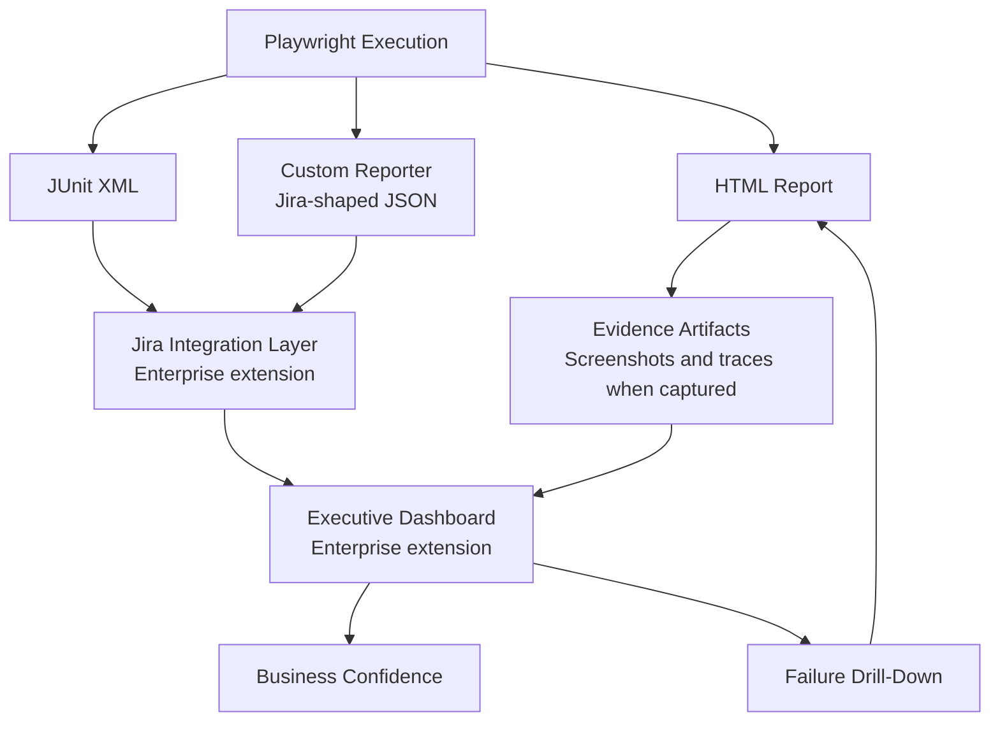
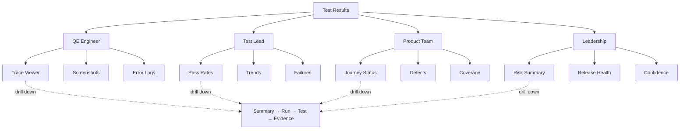
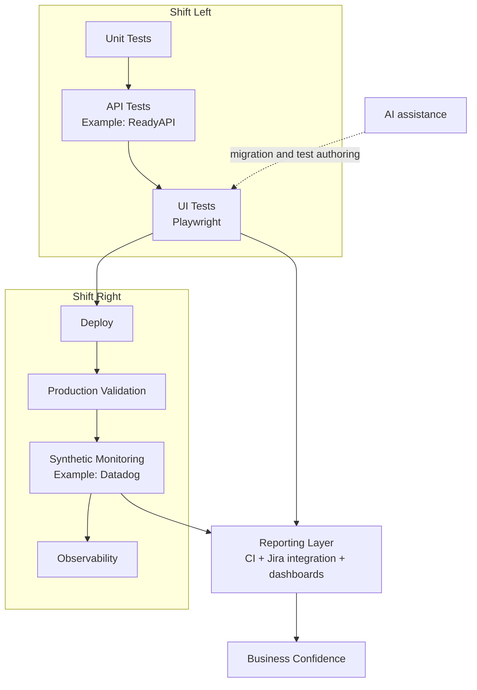

# From Test Execution to Business Visibility

## Reporting, Traceability, and Executive Reporting Architecture

This guide shows how to demo the reporting already in the blueprint, what its Jira-shaped output means, and how a team could connect it to Jira and a test management add-on.

## The honest architecture

```text
Playwright execution
        |
        +--> HTML report ----------------------> Engineer investigates test, error, screenshot, trace
        +--> JUnit XML -------------------------> CI test ingestion
        +--> Custom reporter JSON ------------> Jira / test-management integration handoff
                                                      |
                                                      +--> Test execution status and run metadata
                                                               |
                                                               +--> Dashboard / release summary
                                                                        |
                                                                        +--> Drill down to test evidence
```

The repository implements the Playwright run, the HTML and JUnit reporters, and a custom reporter that writes `test-results/jira-results.json`. The custom reporter currently records a test ID, title, status, first failure line, and labels. It does **not** call Jira, create Jira issues, upload attachments, or make an executive dashboard. The JSON is a local, demo-ready handoff payload. This distinction lets the talk explain the architecture without claiming an integration that is not in the code.

## Run the report demo

From the repository root:

```powershell
cd playwright-ts-modern
npm install
npx playwright install chromium firefox
npm test
npm run report
```

Playwright opens the generated HTML report locally. Select a test to show its outcome and any failure evidence recorded for that run. In another terminal, open these generated files:

- `playwright-report/index.html` — interactive Playwright report.
- `test-results/junit.xml` — standard CI test-results document.
- `test-results/jira-results.json` — custom reporter's Jira-shaped handoff.

These outputs are generated by a test run and are ignored by Git; run the suite before the meetup to refresh them. A successful run may not have failure screenshots or traces because the configuration captures screenshots on failure and traces on first retry. To demonstrate investigation, use a naturally failing test in a disposable branch or show the saved Trace Viewer screenshot in the README. Avoid introducing a failing test into the shared demo branch.

## What the Jira handoff currently contains

The custom reporter maps Playwright results into compact JSON records. A test can specify a stable ID with an annotation:

```ts
test('authenticated user sees the inventory', {
  annotation: { type: 'jira', description: 'INV-001' }
}, async ({ inventoryPage }) => {
  // assertions
});
```

If no `jira` annotation exists, the reporter creates an ID from the test title path. It also copies `label` annotations. The resulting record looks like:

```json
{
  "testId": "INV-001",
  "title": "authenticated user sees the inventory @smoke",
  "status": "passed",
  "failureReason": null,
  "jiraLabels": ["playwright", "smoke"]
}
```

## What Exists Today vs Future Integration

### Implemented in this repository

- Playwright HTML report.
- JUnit XML results.
- Custom Jira-shaped JSON reporter.
- Stable test IDs when a test has a `jira` annotation.
- Labels and test metadata in the JSON output.
- Failure screenshots and traces according to the Playwright configuration.

### Typical enterprise extension

These are integration capabilities a team could add; this repository does not implement them:

- CI pipeline reads the JSON output.
- Jira test execution update through the team's test management integration.
- Defect creation workflow based on agreed rules and triage.
- Evidence upload or links to retained CI artifacts.
- Executive dashboard built from test execution data.
- Release readiness reporting based on agreed quality gates.

For a real Jira update, a CI integration would read this JSON, map each stable test ID to the test case supported by the team's Jira test-management product (for example, an installed test management add-on), create or update a test execution for the build, and publish the run link and evidence. Credentials belong in the CI secret store; the reporter should not contain tokens. The HTML report and trace can be retained as CI artifacts and linked from the execution. Jira by itself is an issue tracker; test-case and test-execution behavior depends on the team's Jira edition and installed integrations.

## Give each audience the view they need

| Audience | Lead with | Drill-down |
|---|---|---|
| QE engineer | Failing test, error, screenshot, trace | HTML report and CI artifact |
| Test lead | Run totals, pass rate, failures by area | JUnit or test execution |
| Product owner | User journeys covered and affected behavior | Linked test cases and defects |
| Manager | Release readiness, blockers, trend | CI run and Jira execution |
| Leadership | Overall risk summary and release confidence | Dashboard link to run details |

An executive summary should use actual run data, not a hard-coded example. For example, if the run reports 200 tests with 195 passed and 5 failed, show those counts and the team's agreed risk rule; do not label risk “Low” automatically from those counts. Risk needs context such as severity, affected journeys, and release criteria.

## Three views of the same execution

```text
ENGINEERING VIEW
Playwright Test
      ↓
HTML Report
      ↓
Trace / Screenshot (when captured)
      ↓
Root Cause Analysis

LEAD VIEW
Playwright Test
      ↓
JUnit / Jira-shaped JSON
      ↓
Test Execution (with an integration)
      ↓
Pass Rate and Trends
      ↓
Release Readiness

EXECUTIVE VIEW
Playwright Test
      ↓
Aggregated Metrics (from reporting systems)
      ↓
Risk Indicators
      ↓
Confidence Summary
```

Different audiences need different views of the same execution data. Preserve a path from summary to run, test, and evidence so a reported risk can be investigated.

## Suggested slide 17: From Test Execution to Business Visibility

Use this deck-ready Mermaid diagram. The report formats are parallel outputs from the same run, so the diagram does not imply that JUnit feeds the custom reporter.



**Bottom message:** “A test isn't finished when it passes. It's finished when the result reaches the people who need it.”

**Speaker notes:** “Automation results have to reach the people who use them. Engineers need failure evidence. Test leads need run trends. Product and delivery leaders need release impact and confidence. In this demo, Playwright generates the detailed HTML report and machine-readable outputs. Our custom reporter creates the JSON handoff. In an enterprise setup, CI can consume that payload and update Jira test management, then publish a dashboard with links back to evidence. This repository demonstrates the handoff; it does not connect to a Jira instance or build the dashboard.”

## Suggested slide 18: One Report Does Not Serve Every Audience

Use this visual instead of presenting the audience needs as a list. The existing audience table below can stay in the written guide as a reference.



**Speaker notes:** “Engineers need evidence. Leads need trends. Product teams need business impact. Leadership needs confidence.”

**30-second demo:** open `playwright-report/` and select a test; show the matching record in `test-results/jira-results.json`; say, “This repository stops here by design. In an enterprise environment, CI consumes this payload and updates Jira test management and reporting systems.” Finish by showing the summary-to-evidence drill-down architecture.

## Optional ecosystem slide: Modern Quality Engineering

Use this as the broader talk context, not as a description of this repository's implementation. It places UI automation alongside API checks, deployment, and production validation.



ReadyAPI, Datadog, Jira integrations, CI pipelines, and production monitoring are ecosystem examples for the presentation; they are not configured or exercised by this sample repository. The repository focuses on the Selenium Java to Playwright TypeScript UI migration and a local reporting handoff.

**Closing line:** “A test result is useful when it reaches the people who need it, with a path back to the evidence.”
